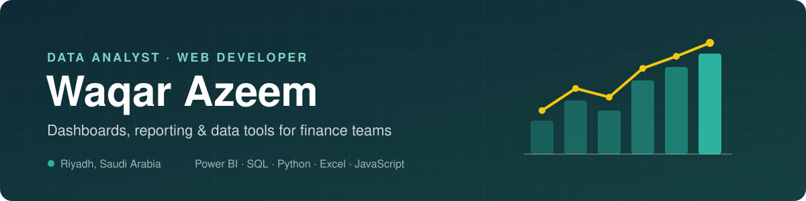
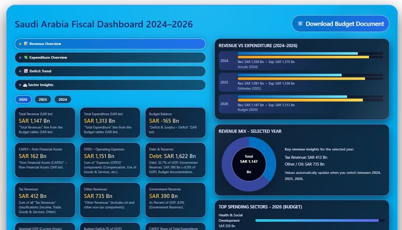
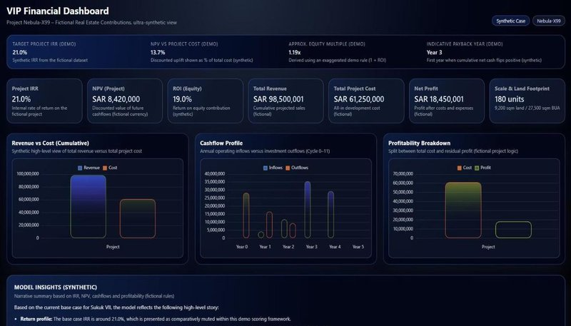
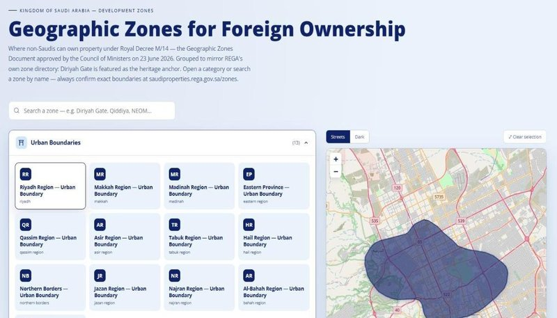

  

I turn messy spreadsheets and business data into **dashboards, reports and tools people actually use**.

 

---

<table>
<tr>
<td align="center" valign="top" width="25%"><h2>📊 50+</h2><b>Dashboards &amp; tools</b> Dashboards, reports and data tools built for finance and accounting clients</td>
<td align="center" valign="top" width="25%"><h2>⏱️ 60%</h2><b>Less manual work</b> Manual calculation time cut with automated accounting and reporting tools</td>
<td align="center" valign="top" width="25%"><h2>🌐 240+</h2><b>Web projects</b> Websites, stores and web tools delivered end to end for clients worldwide</td>
<td align="center" valign="top" width="25%"><h2>🗓️ 7+ yrs</h2><b>Client experience</b> Working with clients and teams across Saudi Arabia, UAE, UK and Pakistan</td>
</tr>
</table>

## 🔍 About me

- 📊 **Data Analyst at Insights KSA (Riyadh)** — dashboards and financial reporting for finance and accounting clients
- ⚙️ Automated accounting tools that **cut manual calculation time by 60%**
- 🌐 **7+ years in web development** (240+ projects) — so I can take an analysis all the way to a working, shareable tool
- 🧾 Hands-on with **Saudi financial data**, VAT and accounting reporting for Riyadh clients
- 🌍 Build **bilingual Arabic / English** pages, calculators and portals — not just spreadsheets
- 🎓 **IBM Data Analyst Professional Certificate** (IBM / Coursera, 2025)

---

## 🛠️ Tech stack

**Data & BI**

**Web**

---

## 📌 Featured projects

<table>
<tr><td width="46%" valign="middle"></td><td width="54%" valign="top">

<h3>Saudi Arabia Fiscal Dashboard 2024–2026</h3>
<b>PUBLIC FINANCE · DATA VISUALIZATION</b>

The Saudi state budget at a glance, built from Ministry of Finance tables — 2024 actuals, 2025 estimates and the 2026 budget side by side.

<ul><li>Revenue vs expenditure, deficit, oil / non-oil mix</li><li>Sector spending, public debt and reserves</li></ul>

✅ <b>Result:</b> One interactive dashboard instead of several static tables — year-on-year changes visible in seconds.

  

</td></tr>
<tr><td width="54%" valign="top">

<h3>Real Estate Investment Dashboard</h3>
<b>FINANCIAL MODELLING · KPIS · SCENARIOS</b>

A three-page investment model that shows whether a project is worth it — and how sensitive the return is.

<ul><li>IRR, NPV, ROI and payback-period KPIs with cash-flow views</li><li>Scenario sliders for revenue, cost and discount rate, with auto-written insights</li></ul>

✅ <b>Result:</b> Best / base / worst cases tested live in a meeting instead of rebuilding spreadsheets.

  

 

</td><td width="46%" valign="middle"></td></tr>
<tr><td width="46%" valign="middle"></td><td width="54%" valign="top">

<h3>Saudi Development Zones Map</h3>
<b>GEOSPATIAL · SEARCH & FILTERS · REAL ESTATE</b>

Interactive map of the 105 zones where non-Saudis can own property under Royal Decree M/14, built for Insights KSA.

<ul><li>Search and filters, with a map and list that stay in sync</li><li>Zone details linked back to official REGA sources</li></ul>

✅ <b>Result:</b> All 105 zones searchable and comparable on one page, a few clicks from the official source.

  

 

</td></tr>
</table>

➡️ Full case studies (challenge → data → approach → result) are on my **[portfolio](https://waqar-azeem-001.github.io/portfolio/)**.

---

## 🧭 How I work

<table>
<tr>
<td align="center" valign="top" width="18%"><h3>1️⃣</h3><b>Understand</b> Agree the business question, the KPIs and who will read the report</td>
<td align="center">➜</td>
<td align="center" valign="top" width="18%"><h3>2️⃣</h3><b>Prepare</b> Pull data with SQL or Excel, fix gaps and duplicates, reconcile totals</td>
<td align="center">➜</td>
<td align="center" valign="top" width="18%"><h3>3️⃣</h3><b>Model</b> Build the data model and measures in Power BI (DAX) or Python</td>
<td align="center">➜</td>
<td align="center" valign="top" width="18%"><h3>4️⃣</h3><b>Visualise</b> Clear dashboards with the 3–5 numbers that matter on the first screen</td>
<td align="center">➜</td>
<td align="center" valign="top" width="18%"><h3>5️⃣</h3><b>Automate</b> Scheduled refresh so the report runs every month without manual work</td>
</tr>
</table>

> I start with the decision someone needs to make — and only then pick the chart, the tool or the formula.

---

## 💼 Experience

<table>
<tr>
<th>🗓️ Period</th>
<th>💼 Role &amp; company</th>
<th>✨ Highlights</th>
</tr>
<tr>
<td align="center" valign="top"><b>Jan 2023</b> to <b>Present</b> 🟢 CURRENT</td>
<td valign="top"><b>Data Analyst</b> Insights KSA 📍 Riyadh (Hybrid)</td>
<td valign="top"><ul><li>Dashboards and financial reporting for finance and accounting clients</li><li>SQL, Excel and Python for data preparation</li><li>Automated accounting tools that cut manual calculation time by <b>60%</b></li></ul></td>
</tr>
<tr>
<td align="center" valign="top"><b>Jan 2022</b> to <b>Dec 2022</b></td>
<td valign="top"><b>Senior WordPress Developer</b> KryptoMind (Pvt) Ltd 📍 Lahore, Pakistan</td>
<td valign="top"><ul><li>WordPress sites for blockchain, e-commerce and marketing clients</li><li>Custom themes, plugins and third-party integrations for client websites</li></ul></td>
</tr>
<tr>
<td align="center" valign="top"><b>May 2021</b> to <b>Dec 2021</b></td>
<td valign="top"><b>Web Developer</b> Rankiz E-Venue 📍 United Arab Emirates</td>
<td valign="top"><ul><li>Responsive e-commerce and marketing websites</li><li>Better navigation, usability and site performance</li></ul></td>
</tr>
<tr>
<td align="center" valign="top"><b>Aug 2018</b> to <b>May 2021</b></td>
<td valign="top"><b>Web Developer</b> E-Tech Marketing 📍 Islamabad, Pakistan</td>
<td valign="top"><ul><li>Client websites with PHP, JavaScript and WordPress</li><li>Server management and production maintenance</li></ul></td>
</tr>
</table>

---

📍 Based in **Riyadh** · Happy to connect with analysts, recruiters and data teams in Saudi Arabia

**[Portfolio](https://waqar-azeem-001.github.io/portfolio/)** · **[LinkedIn](https://www.linkedin.com/in/waqar-azeem)** · **waqarazeem54@gmail.com**

